# 1. Especificação funcional · 2. Fluxo de telas · 3. Telas

## Objetivo e critério de sucesso

Transformar fotos de tickets impressos de ponto em registros pesquisáveis, preservando a imagem
original. **Sucesso:** fotografar um ticket hoje e localizá-lo meses depois por data, horário ou
conteúdo, com a foto original e os dados extraídos disponíveis para conferência.

## Princípios

| Princípio | Como o portal cumpre |
|---|---|
| Local-first | Banco IndexedDB e OCR no navegador. Depois da primeira abertura, funciona sem internet. |
| Nunca presumir | Data, horário e tipo com dúvida exigem confirmação. O tipo nunca é deduzido pela ordem do dia. |
| Original intocável | A foto é guardada exatamente como recebida; o texto do OCR nunca é alterado; correções vão para o histórico. |
| Sem exclusão automática | Duplicidades são apenas sinalizadas. |
| Linguagem cuidadosa | "Diferença indicativa" e "estimativa"; nunca "hora extra", "atraso" ou "infração". |

## Funcionalidades

**Captura** — "Fotografar ticket" abre a câmera traseira; "Importar foto ou arquivo" aceita galeria e
app Arquivos (até 20 por vez, processados em fila: "Ticket 1 de 3", com "Pular"). Editor: recorte pelos
4 cantos, girar 90°, realce (cinza + contraste + ampliação + binarização adaptativa), restaurar.

**Reconhecimento** — extrai, quando impressos: funcionário, matrícula/PIS/CPF (com validação de
dígitos), empresa, CNPJ (numérico e alfanumérico, validado), data, horário (com segundos), tipo,
REP/relógio, NSR/nº do ticket, código de autenticação e "outras informações" (pares rótulo: valor).
Formatos: `22/10/2026`, `22-10-26`, `22.10.2026`, `2026-10-22`, `22 OUT 2026`, `22 de outubro de 2026`,
`08:01`, `08:01:33`, `8h01`. Confusões típicas (`O→0`, `l→1`, `S→5`) são corrigidas **com redução de
confiança**. Vários valores diferentes no mesmo ticket → confiança reduzida e aviso.

**Qualidade da foto** — antes de ler, o portal mede nitidez (horizontal e vertical, pega tremido de
movimento), luz, reflexo e o tamanho do ticket na foto. Se a leitura tende a falhar, avisa e oferece
"Tirar outra foto" (limites calibrados com o benchmark: fotos muito tremidas ou com o ticket minúsculo
não eram lidas).

**Aprendizado com tickets confirmados** — nome, matrícula, empresa, CNPJ e relógio: leitura parecida com
um valor já confirmado é corrigida para ele (ex.: "LTIA" → "LTDA") e o ajuste é mostrado e registrado no
histórico; campo ausente é sugerido (destacado para conferência) quando o mesmo valor já foi confirmado
3+ vezes. O **NSR** é conferido com a data/hora (no mesmo relógio ele só cresce): se não bater, data,
horário e NSR passam a exigir conferência; sem data lida, o portal indica o período provável. Data no
futuro e horário posterior ao momento da foto também são apontados. Só tickets confirmados ensinam.

**Revisão** — confiança Alta/Média/Baixa por campo (texto + %, não só cor). Campos críticos duvidosos
ficam destacados e exigem "Está correto" ou edição. "Salvar e confirmar" só sem pendências; "Salvar para
revisar depois" sempre. Antes de salvar, verifica duplicidade (mesmo código, mesmo NSR no mesmo REP,
mesma data+hora+tipo, imagem parecida) e pergunta.

**Arquivo** — linha do tempo por mês, ordenada pela data/hora impressas; busca sem acentos em todos os
campos, no texto do OCR, observações, etiquetas, nome do arquivo e formas alternativas de data/hora.
Filtros: período, mês/ano, horário, tipo, empresa, funcionário, etiquetas, incompletos, sinalizados,
revisão pendente.

**Detalhe** — foto original (e a recortada) com zoom; dados com confiança; texto do OCR; data de
inclusão; histórico; observações; etiquetas; possíveis duplicidades; compartilhar PDF, compartilhar foto
original, imprimir, excluir (com confirmação).

**Calendário e dia** — grade mensal com contagem e alerta de revisão; dia com marcações, tempo entre
elas, resumo e associação manual de jornada ("Pertence à jornada de dd/mm" para turnos noturnos).

**Jornada (opcional)** — períodos só com tipos confirmados; pendências (início sem fim, fim sem início,
início duplicado, número ímpar, intervalo abaixo da referência); resumo mensal só com dias sem pendências;
dias úteis sem ticket; PDF e CSV; jornada de referência por dia da semana.

**Ajustes** — Face ID/código, backup/restauração, CSV, jornada, política de privacidade, onde os dados
ficam, apagar tudo. Primeira abertura: apresentação de privacidade e opção de proteção.

## Fluxo de telas

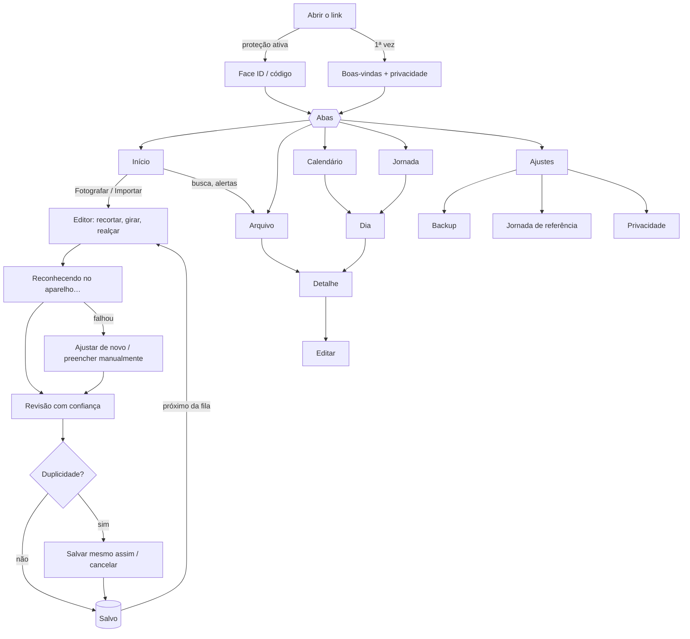

## Telas reais (capturadas no teste automatizado, tamanho de iPhone)

| | | |
|---|---|---|
| 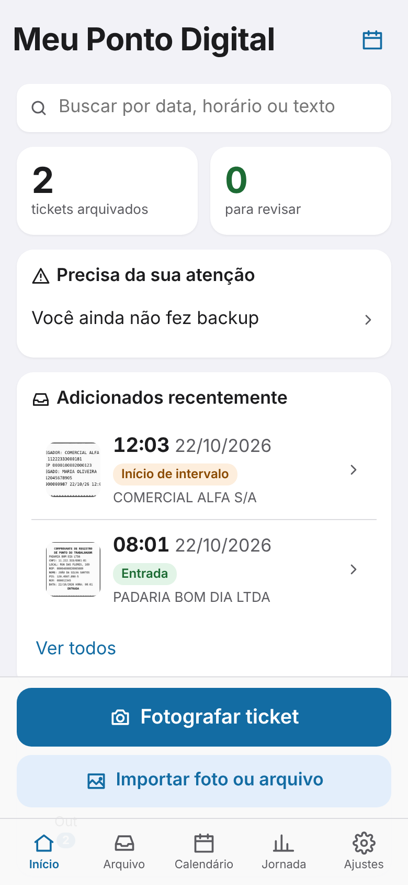 Início | 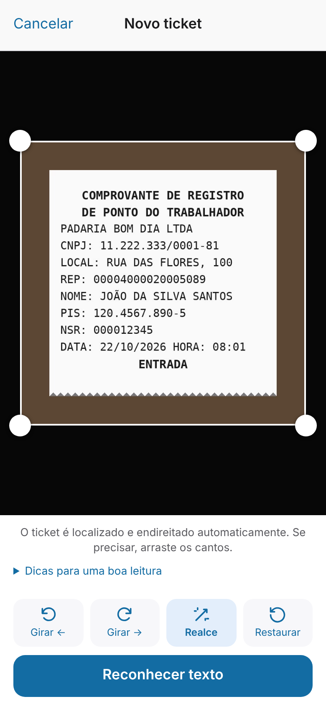 Editor | 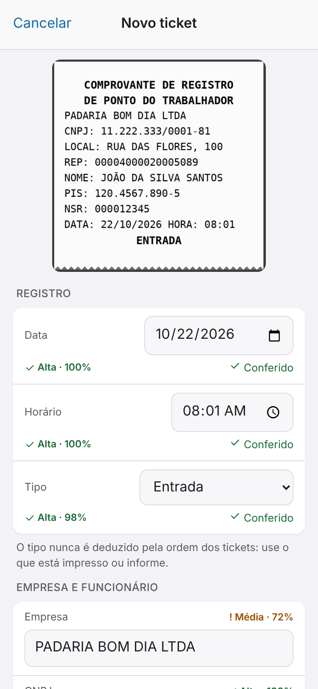 Revisão |
| 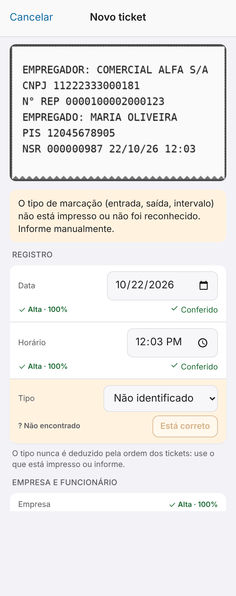 Confirmação obrigatória | 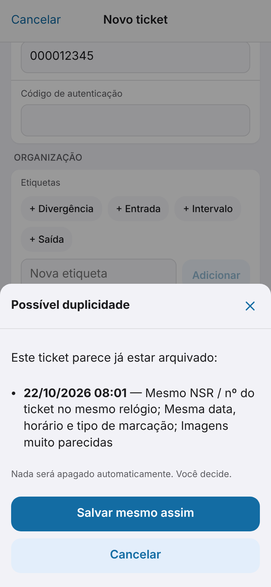 Duplicidade | 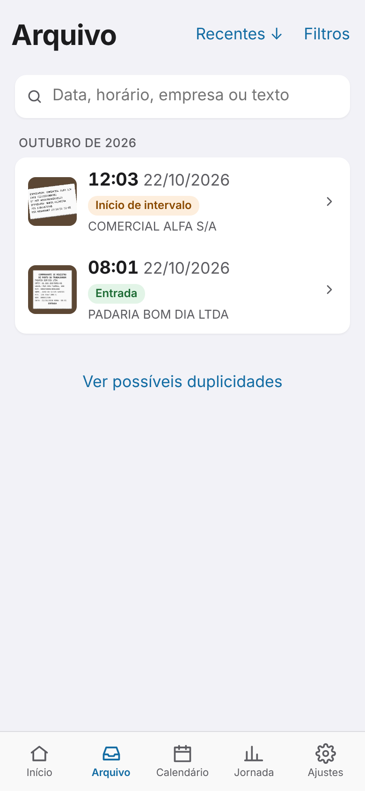 Arquivo |
| 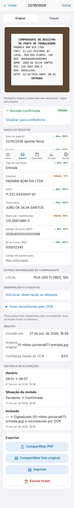 Detalhe | 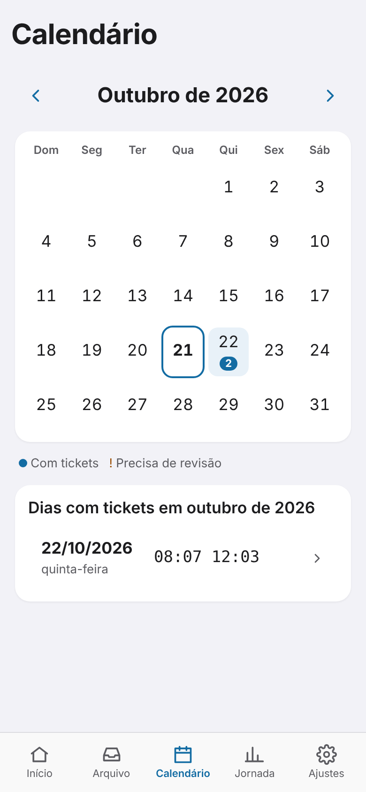 Calendário | 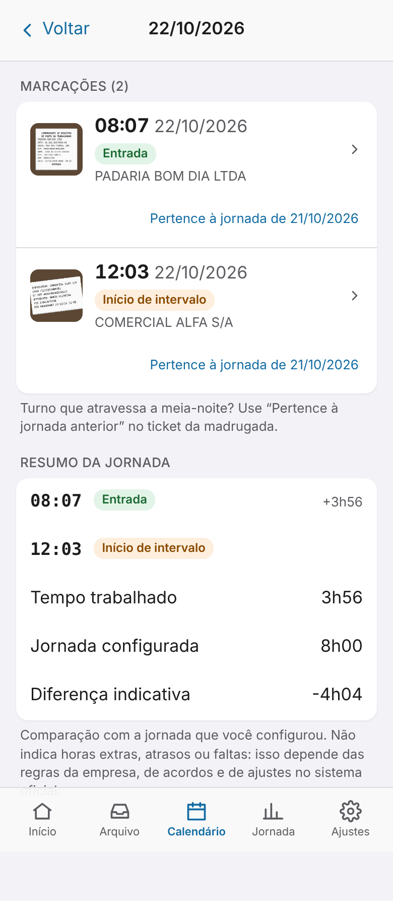 Dia |
| 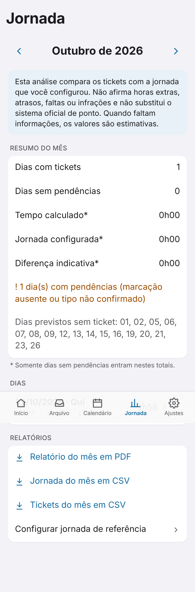 Jornada | 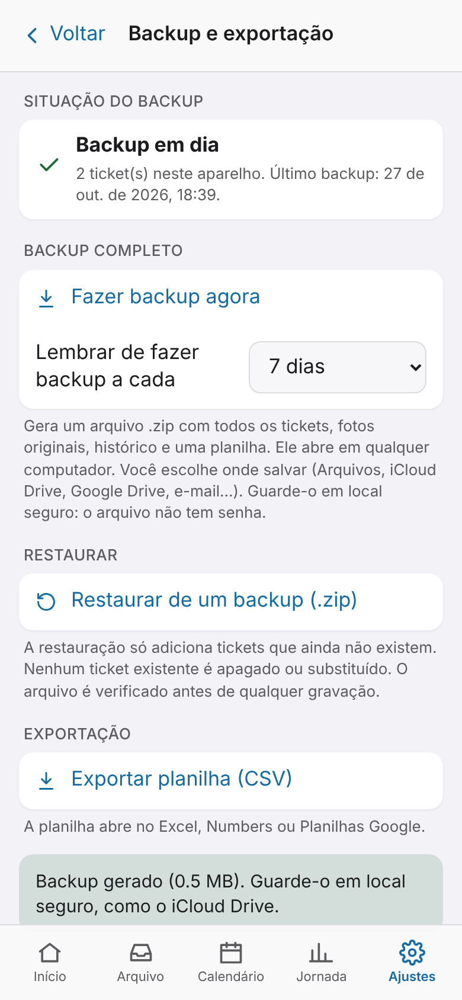 Backup | 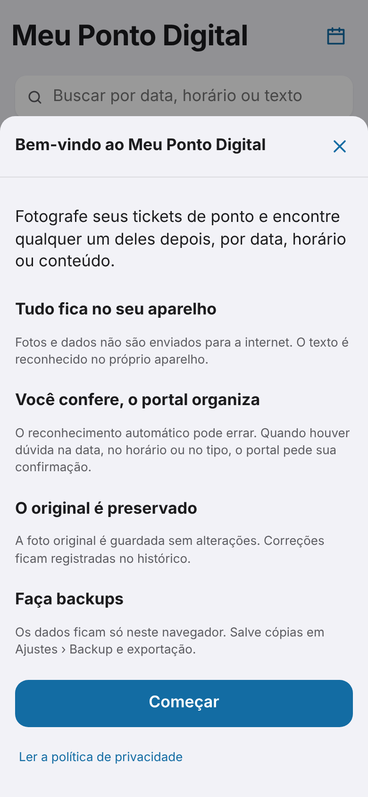 Boas-vindas |
| 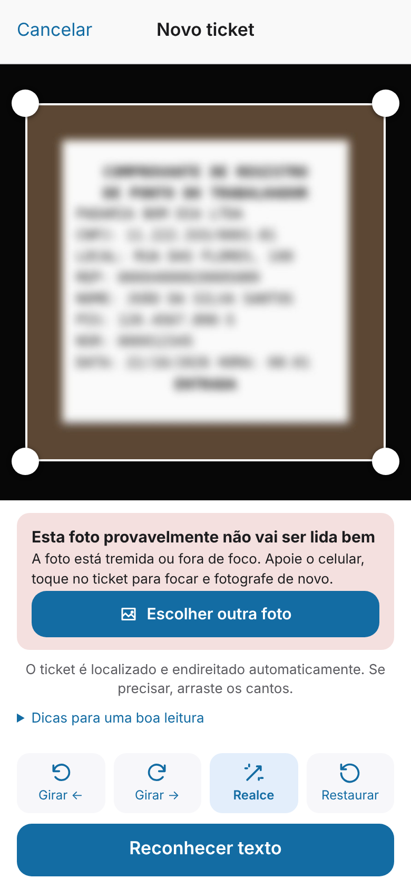 Aviso de foto ruim | 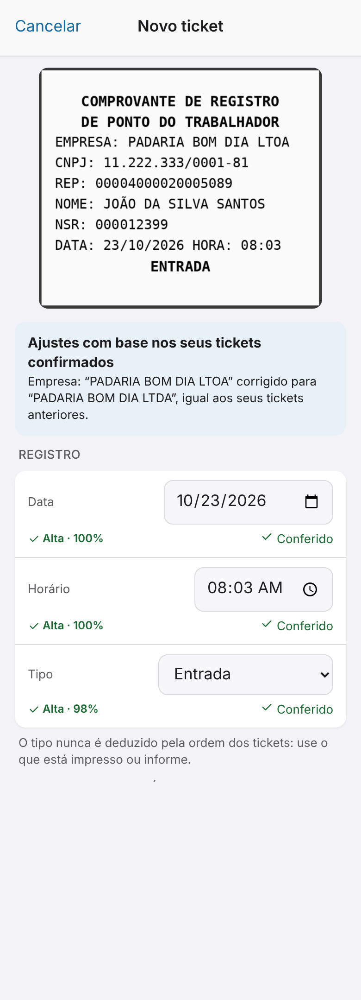 Ajuste por ticket confirmado | |

No navegador de testes (Chromium em inglês) os campos de data/hora aparecem como `10/22/2026` e `PM`;
no iPhone em português aparecem como `22/10/2026` e 24 h.
