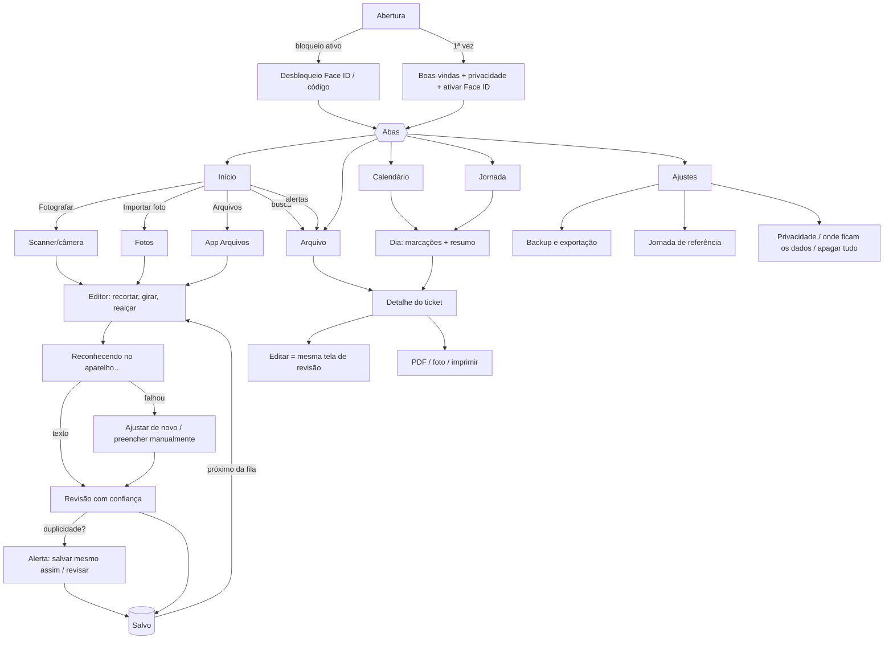

# 1. Especificação funcional e 2. Fluxo de telas

## Objetivo

Transformar fotografias de tickets impressos de registro de ponto em registros digitais
pesquisáveis, preservando a imagem original, para que o usuário encontre um comprovante
meses depois por **data, horário ou conteúdo**.

**Critério de sucesso:** fotografar um ticket hoje e localizá-lo depois, com a imagem
original preservada e os dados extraídos disponíveis para conferência.

## Princípios

| Princípio | Como o app cumpre |
|---|---|
| Local-first | Banco SwiftData e imagens no aparelho. OCR com Apple Vision, sem internet. |
| Nunca presumir | Data, horário e tipo com dúvida exigem confirmação. O tipo nunca é deduzido pela ordem do dia. |
| Original intocável | Bytes da foto gravados sem recompressão; texto do OCR guardado sem alteração; correções vão para o histórico. |
| Sem exclusão automática | Duplicidades são apenas sinalizadas. |
| Linguagem cuidadosa | A análise mostra “diferença indicativa” e “estimativa”; nunca “hora extra”, “atraso” ou “infração”. |

## Funcionalidades (MVP implementado)

### Captura
- **Fotografar ticket** — scanner de documentos do iOS (detecta bordas, corrige perspectiva, várias páginas = vários tickets). Fallback: câmera comum.
- **Importar foto** — galeria (até 10 de uma vez, formato original HEIC/JPEG preservado).
- **Arquivos** — imagens do app Arquivos (nome original do arquivo é registrado).
- **Editor** — recorte pelos 4 cantos, girar 90°, realce de legibilidade (cinza + contraste + nitidez). Opera numa cópia.

### Reconhecimento (OCR + interpretação)
Extrai, quando impressos: funcionário, matrícula/PIS/CPF (com validação de dígitos), empresa,
CNPJ (numérico **e alfanumérico**, com validação), data, horário (com segundos), tipo de marcação,
REP/relógio, NSR/nº do ticket, código de autenticação e “outras informações” (pares rótulo: valor).

- Formatos de data: `22/10/2026`, `22-10-26`, `22.10.2026`, `2026-10-22`, `22 OUT 2026`, `22 de outubro de 2026`.
- Horários: `08:01`, `08:01:33`, `8h01`.
- Correção de confusões típicas do OCR (`O→0`, `l→1`, `S→5`) **com redução da confiança** e aviso.
- Frases de tipo: “Entrada”, “Saída”, “Saída para almoço” (= início de intervalo), “Retorno intervalo” etc.
  Cabeçalhos como “Registro de entrada e saída” são ignorados; tipos conflitantes viram “não identificado”.
- Várias datas/horários diferentes no mesmo ticket → confiança reduzida + aviso.

### Revisão
- Cada campo mostra **confiança Alta / Média / Baixa** (texto + ícone + %, não só cor).
- Campos críticos (data, horário, tipo) com dúvida ficam destacados e exigem **“Está correto”** ou edição.
- **Salvar e confirmar** só fica disponível sem pendências; **Salvar para revisar depois** sempre disponível (fica “pendente”).
- Ao salvar, verifica **possíveis duplicidades** (mesmo código, mesmo NSR no mesmo REP, mesma data+hora+tipo, imagem parecida) e pergunta.
- Correções feitas na revisão em relação ao OCR entram no histórico.

### Arquivo e busca
- Linha do tempo agrupada por mês, ordenada pela **data/horário impressos** (não pela data da foto). Sem data → seção própria.
- Busca textual sem acento/maiúsculas em todos os campos, no texto integral do OCR, observações, etiquetas, nome do arquivo e em formas alternativas: `22/10`, `22/10/26`, `outubro`, `quinta-feira`, `8:01`, `8h01`.
- Filtros: data, período, mês/ano, empresa/CNPJ, funcionário/matrícula, tipo, faixa de horário, etiquetas, incompletos, sinalizados, revisão pendente.

### Detalhe do ticket
1. Foto original (zoom por pinça/toque duplo) e a versão tratada. 2. Texto do OCR (selecionável).
3. Dados estruturados com confiança. 4. Data/hora de inclusão. 5. Histórico de alterações.
6. Observações. 7. Etiquetas (Entrada, Saída, Intervalo, Divergência + personalizadas).
8. Compartilhar PDF, compartilhar foto original, imprimir, excluir (com confirmação).
Também: sinalizar para conferência, possíveis duplicidades com link, outras informações.

### Calendário e dia
- Grade mensal com número de tickets por dia e alerta de revisão; deslizar troca o mês.
- Dia: todas as marcações em ordem, tempo entre elas, resumo da jornada.
- **Associação manual de jornada** (turno noturno): tocar e segurar → “Pertence à jornada de dd/mm”.

### Análise de jornada (opcional, pode ser desligada)
- Pares entrada→saída/intervalo **somente com tipos confirmados**; sem tipo → mostra só os intervalos entre marcações.
- Pendências: marcação de início sem fim, fim sem início, início duplicado, número ímpar, intervalo abaixo da referência.
- Resumo mensal soma só dias sem pendências; lista dias úteis sem ticket. Exporta PDF e CSV.
- Jornada de referência configurável por dia da semana, intervalo de referência.

### Segurança, backup e privacidade
Ver [04-BACKUP-SEGURANCA-PRIVACIDADE.md](04-BACKUP-SEGURANCA-PRIVACIDADE.md).

## Fluxo de navegação

## Telas (resumo)

| Tela | Conteúdo principal | Uso com uma mão |
|---|---|---|
| Início | Busca, total de tickets, pendências, alertas, recentes, últimos dias | Botões de captura **fixos na parte de baixo** |
| Arquivo | Linha do tempo por mês, busca, filtros, ordem, duplicidades | Busca nativa puxando a lista |
| Calendário | Grade mensal, lista de dias com horários | Deslizar para trocar o mês |
| Dia | Marcações, tempos, resumo, associação de jornada | Menu de contexto / deslizar |
| Detalhe | Foto, dados, OCR, histórico, ações | Menu “…” no topo |
| Revisão/edição | Formulário com confiança e confirmações | Botões grandes no fim |
| Jornada | Mês, resumo, dias, exportação | — |
| Ajustes | Face ID, backup, jornada, privacidade | — |

O protótipo visual (6 telas) está publicado em https://claude.ai/artifact/Fh62W8ktAGnvSHxKXZBhdH (privado — compartilhe pelo menu Share se outras pessoas precisarem ver). Os fontes ficam em `docs/prototipo/`.
